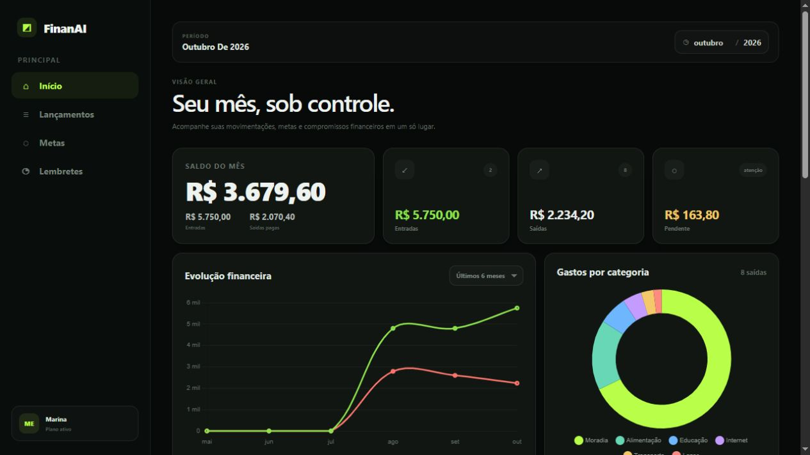
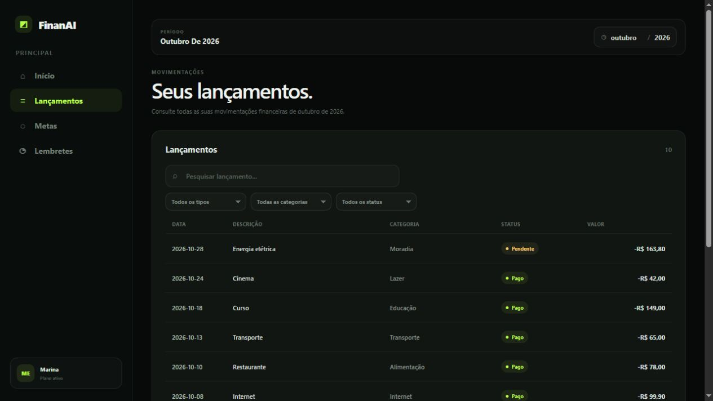
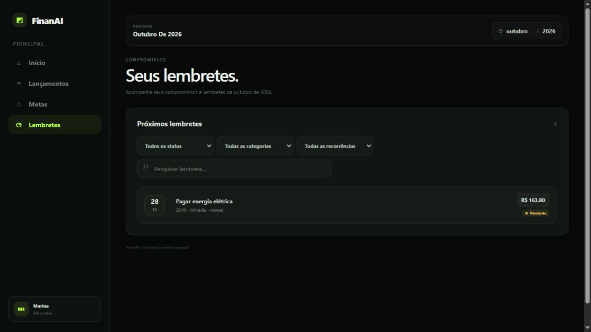
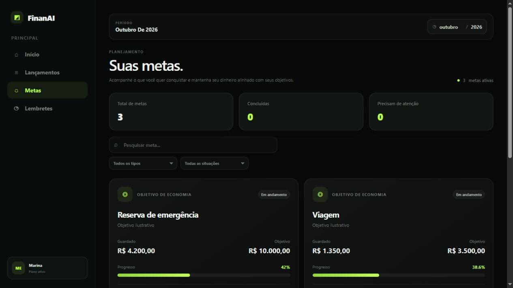
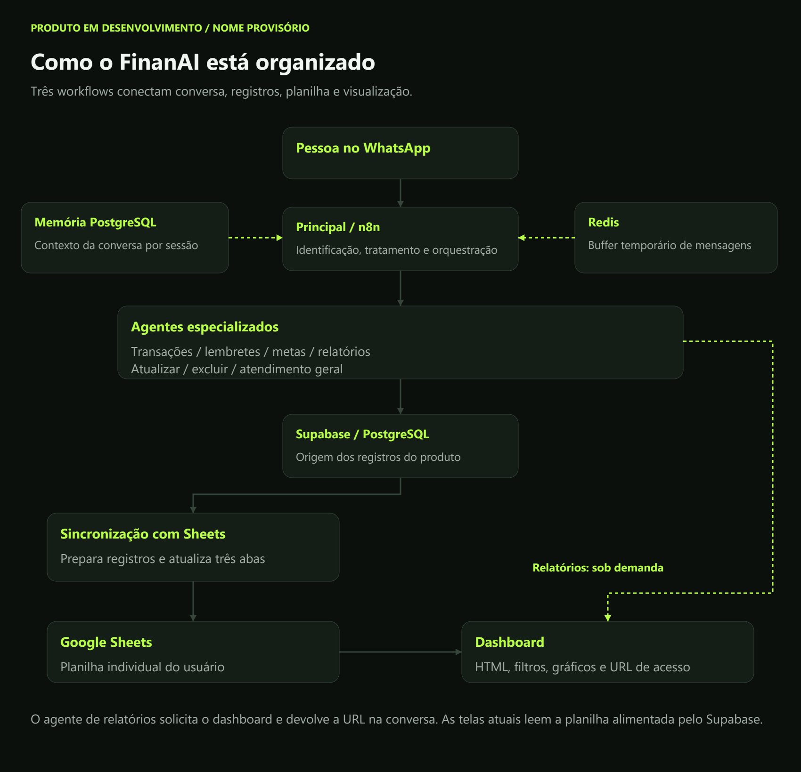

# FinanAI

**Nome provisório | Produto em desenvolvimento | Testes com 5 pessoas**

Estou desenvolvendo um produto de organização financeira que começa em uma
conversa no WhatsApp e conecta os registros a uma visão visual das finanças.
O objetivo é facilitar o registro de movimentações e o acompanhamento de
compromissos no dia a dia.

Hoje estou testando a solução com cinco pessoas próximas. Essa etapa tem um
papel direto nas decisões de produto: entender o que as pessoas realmente usam,
onde encontram dificuldade e quais funcionalidades fazem sentido na rotina.

**Desenvolvimento:** Carlos Vinícius dos Santos Domingos | Diagonal Tech.

*Interface extraída do código atual do dashboard, preenchida com dados fictícios
para apresentação. O nome FinanAI ainda será alterado.*

## O que estou construindo

A experiência combina três partes:

1. **Conversa:** registro e consulta de informações pelo WhatsApp, com agentes
   especializados para cada tipo de solicitação.
2. **Organização:** persistência em Supabase/PostgreSQL e sincronização dos
   registros com uma planilha individual no Google Sheets.
3. **Visualização:** dashboard com visão geral, lançamentos, metas e lembretes.

O produto está em desenvolvimento. Estou evoluindo a implementação e validando
a utilidade das funcionalidades com o grupo de testes antes de ampliar seu uso.

## O que já está sendo usado nos testes

| Área | Situação atual |
| --- | --- |
| Transações | Registro e uso de movimentações confirmados pelo desenvolvedor nos testes |
| Lembretes | Funcionalidade em uso pelo grupo de testes |
| Relatórios | Uso confirmado por meio do dashboard e do Google Sheets |
| Dashboard | Boa recepção inicial; pedidos por novas visões orientam a evolução |
| Google Sheets | Parte da experiência de consulta já utilizada nos testes |
| Metas | Agente e interface presentes na implementação; acompanhamento específico de uso ainda a consolidar |
| Cartões | Melhorias de visualização solicitadas pelos participantes e em desenvolvimento |

Ainda não tenho uma medição que indique qual recurso é o mais utilizado.
Os retornos desta fase são qualitativos e vêm de um grupo inicial de cinco pessoas.

## A interface atual

Os lançamentos podem ser consultados por período, com pesquisa e filtros por
tipo, categoria e situação de pagamento.

A tela de lembretes reúne compromissos e permite pesquisar e filtrar os registros.

A implementação de metas possui objetivos de economia e limites de gasto.
Sua presença na interface não representa uma medição de adoção pelo grupo.

Todas as capturas acima utilizam dados fictícios. Detalhes em
[sobre as imagens](docs/SOBRE-AS-IMAGENS.md).

## Como organizei a solução

### 1. Agente principal

Recebe eventos do WhatsApp pela Evolution API, identifica o usuário e trata
as mensagens antes de encaminhá-las ao orquestrador. Há caminhos para texto,
transcrição de áudio, análise de imagem e extração de PDF.

O orquestrador direciona as solicitações a agentes de transações, lembretes,
metas, relatórios, alterações, exclusões e atendimento geral. A memória
conversacional está conectada ao PostgreSQL; Redis aparece no buffer de mensagens.

### 2. Sincronização com Google Sheets

Um subworkflow consulta os registros do usuário no Supabase, prepara os dados
e atualiza as abas de transações, metas e lembretes de sua planilha. Quando
necessário, copia uma planilha modelo e associa seu identificador ao usuário.

O Supabase é a origem dos registros. A sincronização é unidirecional para a
planilha, que participa da camada atual de consulta e visualização.

### 3. Dashboard

O agente de relatórios pode chamar o workflow de dashboard e receber sua URL.
O dashboard consulta as abas da planilha e gera a interface em HTML, CSS e
JavaScript, com gráficos em Chart.js e seleção de período.

A [arquitetura detalhada](docs/ARQUITETURA.md) explica as ligações entre os fluxos.

## Tecnologias utilizadas

| Tecnologia | Responsabilidade |
| --- | --- |
| n8n | Orquestração dos três workflows, agentes e tarefas agendadas |
| Evolution API | Comunicação com o WhatsApp e obtenção de mídia |
| Modelos OpenAI | Interpretação, agentes especializados e análise de imagem |
| Groq/Whisper | Transcrição de áudio |
| Supabase/PostgreSQL | Usuários, transações, categorias, metas, lembretes e memória |
| Redis | Buffer temporário de mensagens |
| Google Drive e Google Sheets | Criação da planilha individual e atualização das abas |
| HTML, CSS, JavaScript e Chart.js | Interface e gráficos do dashboard |

## O que os testes já estão mudando

O dashboard recebeu uma boa avaliação inicial do grupo. Os participantes
pediram melhores visões de cartões de crédito e outros cartões, e estou
incorporando essa demanda à próxima evolução.

Essa é a etapa que quero compartilhar: construir, colocar em uso, ouvir e
ajustar. Uma ideia interessante para quem desenvolve precisa também encontrar
utilidade na rotina de quem vai usar.

## Próximas evoluções

- Evoluir as visões de cartões a partir do feedback recebido.
- Acompanhar frequência de uso e dificuldades por funcionalidade.
- Consolidar o comportamento das operações de registro, consulta e alteração.
- Melhorar consistência, recuperação de falhas e controle de acesso entre os fluxos.
- Definir o nome e a identidade definitiva do produto.

As prioridades podem mudar com os testes. Novos recursos serão apresentados
conforme forem integrados e validados.

## Acompanhe a evolução

O [registro de evolução](EVOLUCAO.md) apresenta o estágio atual e as decisões
tomadas a partir do uso. A [apresentação visual](apresentacao-produto.pdf)
resume o produto, a implementação e os próximos passos.

Este espaço acompanha o desenvolvimento do produto. Os workflows de produção,
credenciais e dados dos participantes não estão incluídos nos materiais de apresentação.

## Disponibilidade do código

Este é um produto proprietário, em desenvolvimento. O repositório reúne sua
apresentação pública, evolução, diagramas e capturas de interface. Código-fonte,
workflows n8n, prompts, rotinas SQL e dados dos participantes permanecem privados.
